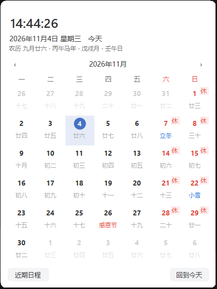
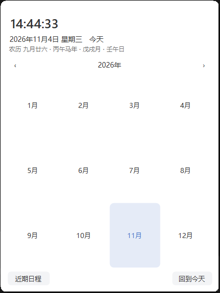
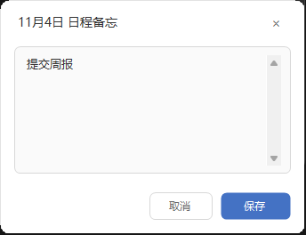

# Hi, I'm Quan

Independent developer building practical web products, AI tools, automation systems, and content-driven websites.

## Selected work

| Project | What it is |
| --- | --- |
| [Binary Code Translator](https://binary-code-translator.com/) | Binary, text, Base64, number-base, and encoding tools. |
| [QuestHub](https://questhub.uk/) | Hand-picked browser games you can play instantly, with source and license transparency. |
| [RunningBai](https://www.runningbai.cn/) | My technical blog about development, infrastructure, AI coding, and building products. |
| [OpenClaw Nav](https://openclawnav.com/) | Guides, deployment references, comparisons, and resources around OpenClaw. |
| [Warhounds](https://warhounds.org/) | A focused game guide and reference site. |
| [Sandustry](https://sandustry.top/) | Guides, mechanics, and reference content for Sandustry. |
| [CutoutUp](https://cutoutup.com/) | AI video background removal — people cutouts with transparent WebM export, green screen, and GIF cutouts; processed locally in your browser. |

## Featured: ChinaTimeWidget

[ChinaTimeWidget](https://github.com/oyjq0000/ChinaTimeWidget) replaces the Windows taskbar clock with China Standard Time (UTC+8) and adds a Chinese lunar calendar flyout: lunar dates, solar terms, festivals, ganzhi, statutory holidays with auto-updated tiaoxiu (holiday-cn), agendas with reminders, a recent-agenda view, dark mode, accent colors, and a year/month picker — single-file C# WinForms, zero third-party dependencies (MIT).

| | | | |
| :---: | :---: | :---: | :---: |
|  |  |  |  |
| taskbar clock | calendar flyout | year/month picker | agenda editor |

## What I build

- AI-assisted development and content workflows
- Browser automation and local agent tooling
- Data collection, monitoring, and research pipelines
- SEO, localization, and content-quality automation
- Static-first websites and developer tools

## Open source

- [ChinaTimeWidget](https://github.com/oyjq0000/ChinaTimeWidget) — taskbar China-time clock + lunar calendar flyout for Windows (MIT)
- [BinaryCodeTranslator](https://github.com/oyjq0000/BinaryCodeTranslator) — converter tools powering binary-code-translator.com
- [TimeQuad](https://github.com/oyjq0000/TimeQuad) — quadrant-based task management with Pomodoro focus sessions

Some production repositories are private while the products themselves are public.

## Stack

Python · TypeScript · C# · WinForms · Astro · Next.js · FastAPI · Cloudflare · Docker · GitHub Actions
